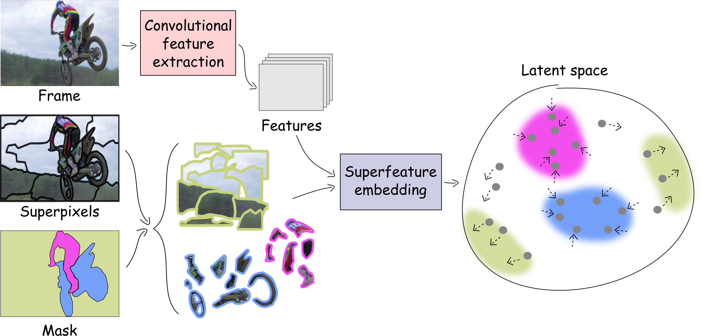
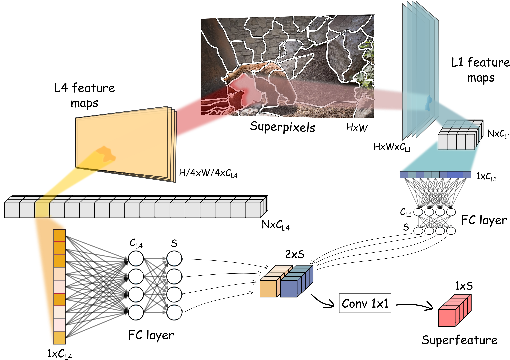
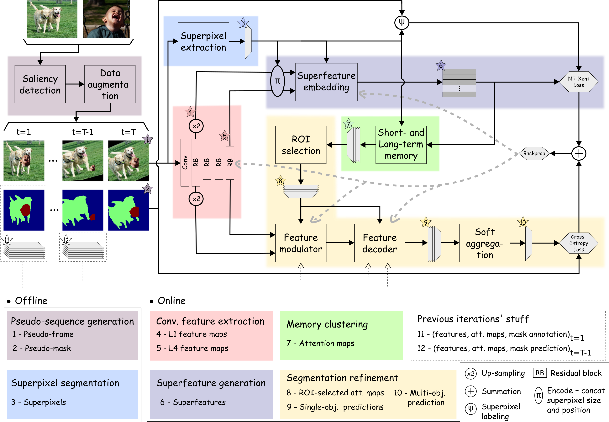

# SHLS: Superfeatures learned from still images for self-supervised VOS

BMVC 2023 paper and materials: https://bmvc2023.cvml.group/proceedings/

Concept:

Superfeatures:

Framework:

Requirements:
- pytorch
- opencv
- tensorboardx
- [pytorch-metric-learning](https://github.com/KevinMusgrave/pytorch-metric-learning)
- faiss

Weights [here](https://drive.google.com/file/d/1E9mVEcRX3uwmdykQv5hveXmnPrW9tM_u/view?usp=sharing)

Folder structure:
- root
- databases
   - MSRA
      - MSRA10K_Imgs_GT
         - train.txt 
         - val.txt
         - Imgs
         - saliency
            
    - DAVIS2017
        - Annotations
        - ImageSets
        - JPEGImages

Citation:
   - MENDONÇA, M.; FONTINELE, J.; OLIVEIRA, L. SHLS: Superfeatures learned from still images for self-supervised VOS. In: British Machine Vision Conference (BMVC), 2023. In: https://papers.bmvc2023.cvml.group/0523.pdf
